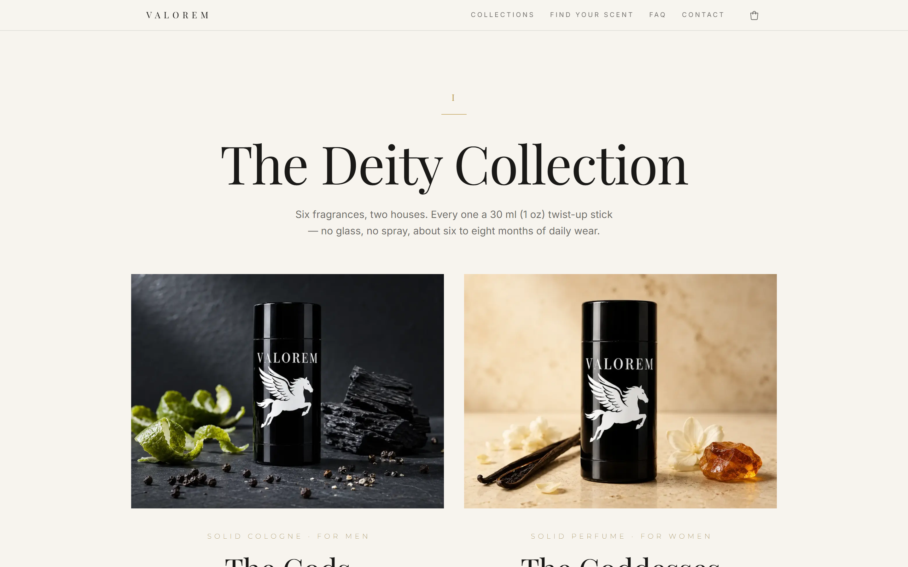
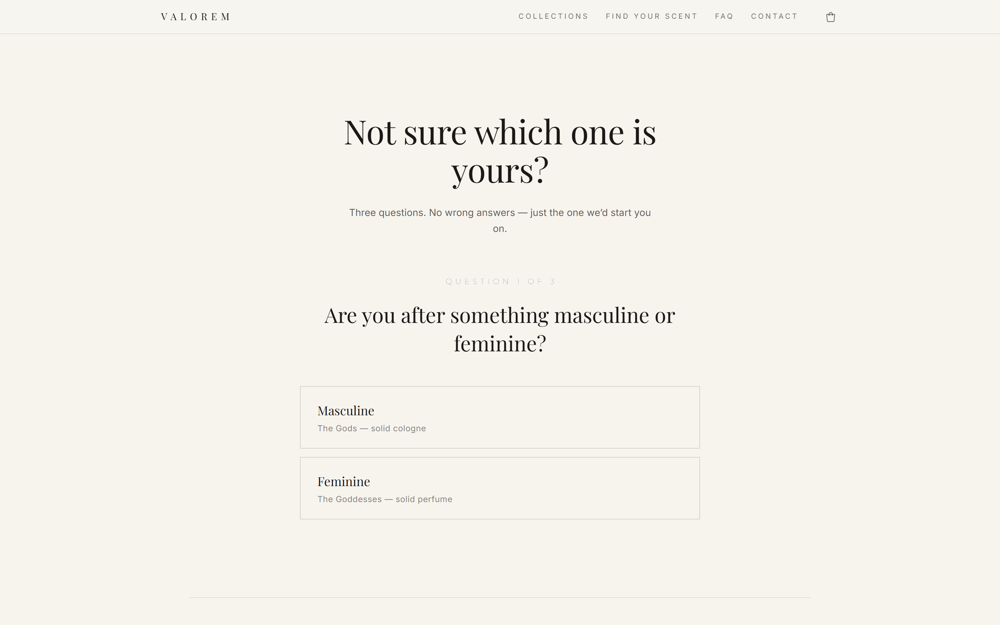

# VALOREM — Headless Shopify Storefront

A production e-commerce storefront for **VALOREM**, a solid-fragrance brand I founded. Built with Next.js on top of Shopify's Storefront and Admin APIs and deployed to a custom domain.

**Live site:** [valoremfragrances.com](https://www.valoremfragrances.com)


| Collections | Scent quiz | Mobile |
| --- | --- | --- |
|  |  |  |

## Tech stack

- **Next.js 16** (App Router, React Server Components, static generation + ISR)
- **React 19**, **TypeScript**
- **Tailwind CSS v4** (CSS-first config, custom design tokens)
- **Shopify** Storefront API (catalog, cart, checkout) and Admin API (customers / email capture)
- **Meta Pixel + Conversions API**, **Judge.me** reviews, **Vercel** hosting and analytics

## Architecture

```
Browser ──► Next.js on Vercel ──► Shopify Storefront API  (products, prices, cart, checkout)
              │                ├─► Shopify Admin API       (email subscribers)
              │                ├─► Judge.me API            (reviews)
              │                └─► Meta Conversions API    (server-side events)
              └─ Server components + /api route handlers; no API token reaches the browser
```

| Route | What it does |
| --- | --- |
| `/` | Marketing home |
| `/collections`, `/collections/[collection]` | Collection grid and per-house pages (statically generated) |
| `/product/[scent]` | Product pages with size variants, gift ladder, gallery, reviews, JSON-LD |
| `/quiz` | Three-question scent finder that recommends a product |
| `/api/cart` | Cart drawer backend — create, add, update lines |
| `/api/checkout` | Creates a Shopify checkout and returns its URL |
| `/api/subscribe` | Email capture into Shopify customers |
| `/api/events` | Relays pixel events to Meta's Conversions API |

## Engineering decisions

- **Prices are live from Shopify, not hardcoded.** Product pages read price and compare-at price from the Storefront API, so starting a sale is an admin change, not a deploy. Pages revalidate hourly, with an in-memory 5-minute variant cache and code fallbacks if Shopify is unreachable.
- **The client never chooses what it buys.** The browser sends a scent id and a size id; the server validates both and resolves the Shopify variant itself, so the purchasable catalog is defined in one place.
- **Single source of truth for catalog content.** Scents, note pyramids, sizes, collections and shipping terms live in `src/lib/site.ts`. Adding a product means adding one entry; routing, collection pages and product pages follow.
- **Server-only credentials.** All Shopify, Judge.me and Meta tokens stay in route handlers and server components. Admin tokens come from an OAuth client-credentials grant and are cached and refreshed before expiry.
- **Deduplicated analytics.** Browser pixel events and server-side Conversions API events share an `event_id`, so Meta counts each event once while still capturing users who block the pixel.
- **Data-driven scent quiz.** Questions and a per-scent scoring table live in `src/lib/scentQuiz.ts` and reference products only by id, so adding a scent means adding its weights — the quiz never duplicates catalog copy.
- **Size-based gift ladder.** Free gifts unlock by size and render as locked/unlocked cards directly under the size selector, driven by shared selected-size state.
- **No fake social proof.** The reviews layer renders nothing until a real customer review exists, and the quiz shows no invented match percentages.
- **SEO.** Centralized metadata, canonical URLs, Product JSON-LD structured data, and 301 redirects for retired routes that ads still link to.
- **No animation libraries.** Scroll reveals use `IntersectionObserver`, and `prefers-reduced-motion` is respected.

## Running locally

```bash
npm install
cp .env.example .env.local   # fill in your own Shopify credentials
npm run dev                  # http://localhost:3001
```

You need a Shopify store with a Headless channel (Storefront token) and a Dev Dashboard app (Admin client id/secret). Meta, Judge.me and Web3Forms are optional.

```bash
npm run lint
npm run build
```

## Project structure

```
src/
  app/          routes, layouts, API route handlers
  components/   UI components (cart drawer, gallery, size selector, reviews…)
  lib/          shopify.ts, site.ts (catalog), seo.ts, reviews.ts, metaCapi.ts
scripts/        media tooling (image normalization, cutouts)
```

## What's next

- Unit tests for the Shopify client and API route validation
- Playwright end-to-end test for add-to-cart → checkout
- Lighthouse / Core Web Vitals budget in CI

---

Brand name, product photography and copy © VALOREM. Code shared for portfolio purposes.
